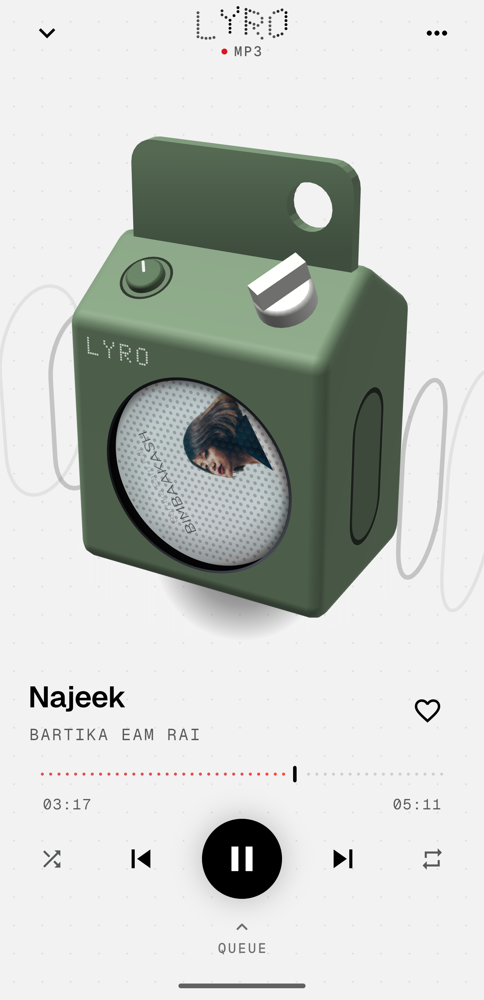
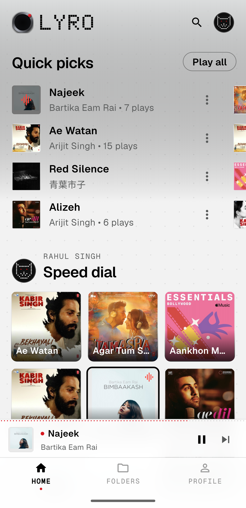
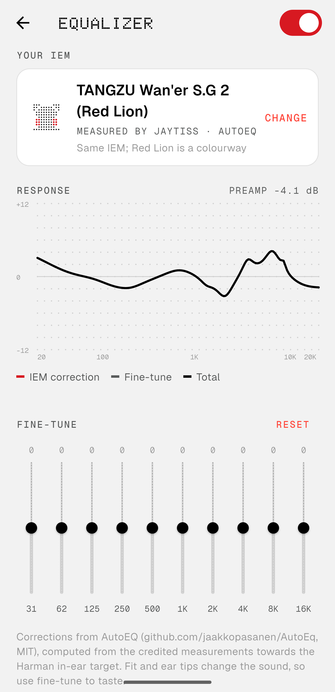

<div align="center">

<br>

<picture>
  <source media="(prefers-color-scheme: dark)" srcset=".github/readme/lyro-dark.svg">
  
</picture>

<br><br>

`OFFLINE MUSIC PLAYER` &nbsp;·&nbsp; `FLUTTER` &nbsp;·&nbsp; `ANDROID`

<sub>Your music. Your device. Nothing else.</sub>

<br>

[](https://flutter.dev)
[](#-04--build)
[](#-01--about)
[](LICENSE)

<br>

&nbsp;&nbsp;
&nbsp;&nbsp;


</div>

<br>

## ● 01 — ABOUT

Lyro is a music player for the files already on your phone. No account, no cloud, no
tracking. Just your library, played well, in a monochrome dot-matrix interface inspired by
Nothing OS and Auxio.

<br>

## ● 02 — FEATURES

```
PLAYBACK ············ gapless queue · track fades · sleep timer · end-of-track stop
LIBRARY ············· songs · albums · artists · folders · playlists · favourites
SMART LISTS ········· most played · recently added · forgotten tracks
EQUALIZER ··········· 32-band IEM correction · AutoEQ catalogue · manual fine-tune
LYRICS ·············· .lrc files · embedded tags · LRCLIB, cached on device
ARTWORK ············· MediaStore · embedded tags · folder.jpg · optional online lookup
WIDGETS ············· now playing · disc · bar · quick mixes
CONTROLS ············ notification · lock screen · headset · bluetooth
FORMATS ············· FLAC · WAV · MP3 · AAC / M4A · OPUS
THEMES ·············· dark · light · speaker colourways
```

<br>

## ● 03 — DESIGN

| | |
|:--|:--|
| `TYPE` | **Doto** dot-matrix for display · **Geist** for interface · **Geist Mono** for data · **Newsreader** italic for accents |
| `COLOUR` | Black, white and grey. One signal red: `#D71921` |
| `SURFACE` | 1 px hairline borders, flat cards, procedural dot fields |
| `MOTION` | Purposeful and quiet. Respects *reduce motion* |

<details>
<summary><code>COLOUR TOKENS</code></summary>
<br>

| Token | Dark | Light | Use |
|:--|:--:|:--:|:--|
| `bg` | `#000000` | `#F2F2F2` | Screen canvas |
| `surface` | `#0C0C0C` | `#FFFFFF` | Cards |
| `raised` | `#171717` | `#EDEDED` | Placeholders, search |
| `line` | `#262626` | `#E2E2E2` | Hairlines |
| `primary` | `#EDEDED` | `#1C1C1C` | Body text |
| `secondary` | `#8C8C8C` | `#585A5A` | Artist, album |
| `accent` | `#D71921` | `#D71921` | Signal, active state |

</details>

<br>

## ● 04 — BUILD

```bash
git clone https://github.com/virus71-alt/Lyro.git
cd Lyro
flutter pub get
flutter run
```

```bash
flutter build apk --release
```

`REQUIRES` Flutter 3.x · Java 17 · Android 7.0+ (API 24)

<br>

## ● 05 — STRUCTURE

```
lib/
├── core/        constants · permissions · settings · theme · utils
├── data/        models · repositories · services (audio, artwork, lyrics, widgets)
├── features/    library · player · eq · playlists · search · profile · settings
└── shared/      nothing-style widgets

android/         native EQ engine (DynamicsProcessing) · home-screen widgets
marketing/       brand marks · launch visuals
```

Playback runs on [`just_audio`](https://pub.dev/packages/just_audio) and
[`audio_service`](https://pub.dev/packages/audio_service). Position ticks go through
`ValueNotifier`s, so the UI only rebuilds what moves.

<br>

## ● 06 — CREDITS

- Fonts: **Doto**, **Geist / Geist Mono** (Vercel), **Newsreader**. All SIL Open Font License 1.1
- EQ data: [AutoEq](https://github.com/jaakkopasanen/AutoEq) by Jaakko Pasanen
- Lyrics: [LRCLIB](https://lrclib.net)
- Design reference: [vibe-nothing-ui-design](https://github.com/wangbh030722/vibe-nothing-ui-design)

Lyro is an independent project. It isn't affiliated with Nothing Technology.

<br>

<div align="center">

<sub><code>● DOYALABS</code></sub>

</div>
